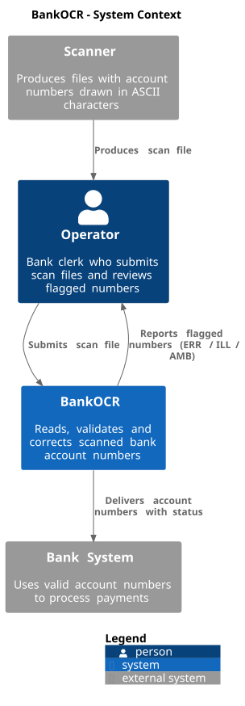

# 3. System Scope and Context

## 3.1 System Scope

**Inside the scope of BankOCR:**

- Reading ASCII digits from a scan file and recognising 9-digit account numbers.
- Validating each account number with the checksum formula.
- Attempting to correct wrong or unreadable entries.
- Marking entries as `ERR`, `ILL` or `AMB` when applicable.
- Writing a result file with one account number per line.

**Outside the scope of BankOCR:**

- Scanning paper documents (done by the Scanner).
- Processing payments with the validated numbers (done by the Bank System).
- Manual review of flagged numbers (done by the Operator).

## 3.2 Business Context

**BankOCR**

| Communication partner | Inputs (to BankOCR) | Outputs (from BankOCR) |
|-----------------------|---------------------|------------------------|
| **Operator** | Scan file path (CLI argument). The file contains entries of 4 lines: 3 lines of 27 characters (`_`, `\|`, space) and a blank line. | Result file with one account number per line, optionally followed by `ERR`, `ILL` or `AMB`. |
| **Bank System** | (none) | Result file with one account number per line, optionally followed by `ERR`, `ILL` or `AMB`. |

The Scanner is not a direct communication partner of BankOCR. The Operator
takes the scan file from the Scanner and submits it to BankOCR. The Operator
also reviews the flagged numbers in the result file.

## 3.3 Technical Context

| Interface | Channel | Format | Protocol |
|-----------|---------|--------|----------|
| Scanner to Operator | File on disk | 4-line entries: 3 lines of 27 characters (`_`, `\|`, space) + 1 blank line | Local file system |
| Operator to BankOCR | CLI argument | Scan file path | Command line |
| BankOCR to Operator | File on disk | One account number per line, optionally with `ERR`, `ILL` or `AMB` | Local file system |
| BankOCR to Bank System | Result file | Same format as the result file the Operator reviews | BankOCR writes the result file; delivery to the Bank System is outside the scope |

All data exchange between the Operator and BankOCR is through plain text files
on the local file system and the command line. BankOCR itself does not use a
network connection.

## 3.4 System Context Diagram

The diagram shows:

- The **Scanner** (external) produces the scan file and hands it to the Operator.
- The **Operator** submits the scan file to BankOCR and receives the result file
  with flagged numbers.
- **BankOCR** (the system) reads the scan file, validates and corrects the
  account numbers, and delivers the result to the Bank System.
- The **Bank System** (external) uses the validated account numbers to process
  payments.
