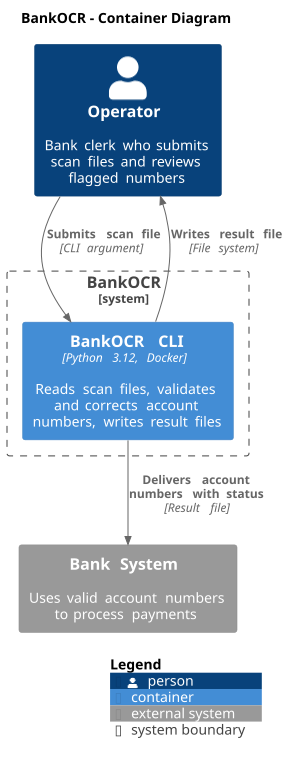
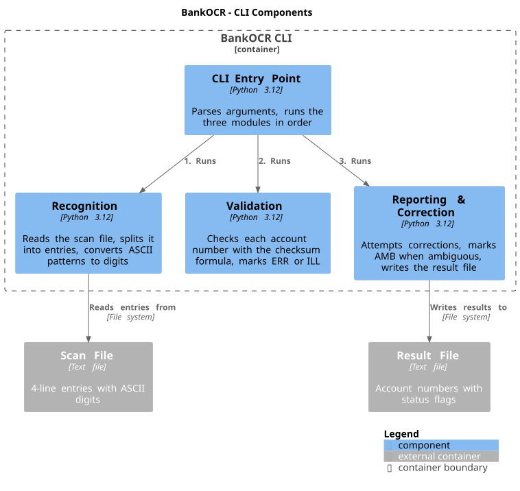

# 5. Building Block View

## 5.1 Level 1: System

At the top level, BankOCR is a single system that the Operator interacts with.
This view is shown in the System Context diagram (Chapter 3).

## 5.2 Level 2: Container

BankOCR is a single container: one CLI process packaged as a Docker image. It
runs on the local machine. The container reads a scan file from the file
system and writes a result file back to the file system.

## 5.3 Level 3: Components

Inside the CLI container, there are four components:

| Component | Responsibility |
|-----------|---------------|
| **CLI Entry Point** | Parses command-line arguments (input file path, output file path), runs the three modules in a fixed order, and passes the output file path to Reporting & Correction. |
| **Recognition** | Reads the scan file, splits it into 4-line entries, and converts the ASCII patterns of each entry into a 9-digit account number. Digits that cannot be recognised are marked as unreadable (`?`). |
| **Validation** | Checks each recognised account number with the checksum formula. Numbers that fail the checksum are marked `ERR`. Numbers with unreadable digits are marked `ILL`. |
| **Reporting & Correction** | Attempts to correct entries marked `ERR` or `ILL` by trying alternative digit interpretations. If exactly one alternative passes the checksum, the number is replaced. If more than one passes, the entry is marked `AMB`. If no alternative passes, the entry keeps its status. Writes the result file with one account number per line. |

The CLI Entry Point runs the three modules in a fixed order. The modules do
not call each other, so each module stays independent and can be tested on its
own with plain text input.

## 5.4 Important Interfaces

The CLI Entry Point takes the result of one module and passes it to the next.
All data between modules goes through the CLI Entry Point. There are no network
calls or external APIs.

| From | To | Data passed |
|------|----|-------------|
| CLI Entry Point | Recognition | Input file path |
| CLI Entry Point | Validation | Entries produced by Recognition, each with 9 digits or `?` for unreadable digits |
| CLI Entry Point | Reporting & Correction | Output file path |
| CLI Entry Point | Reporting & Correction | Entries with status produced by Validation: valid, `ERR` or `ILL` |
| Reporting & Correction | Output file | Account numbers with final status: valid, `ERR`, `ILL` or `AMB` |
