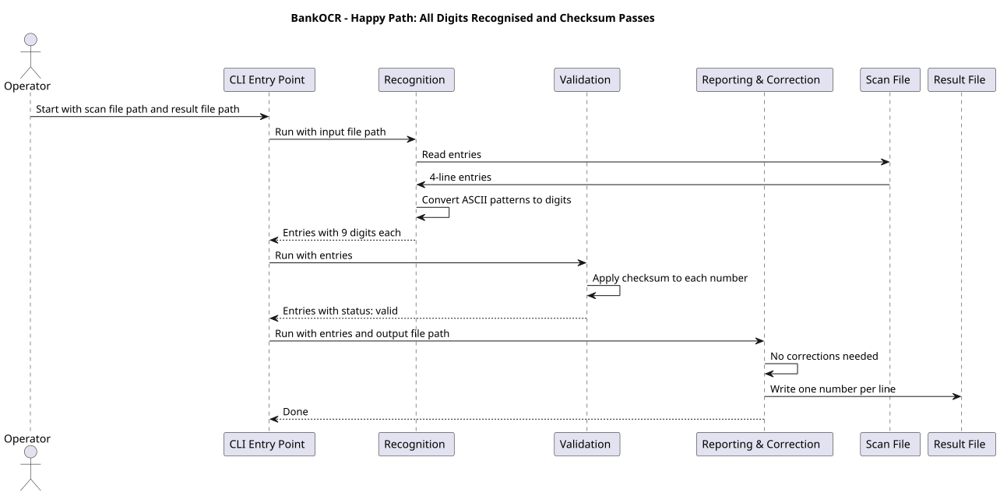
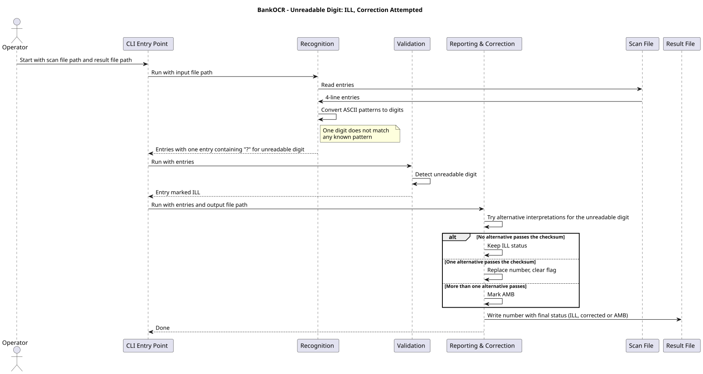
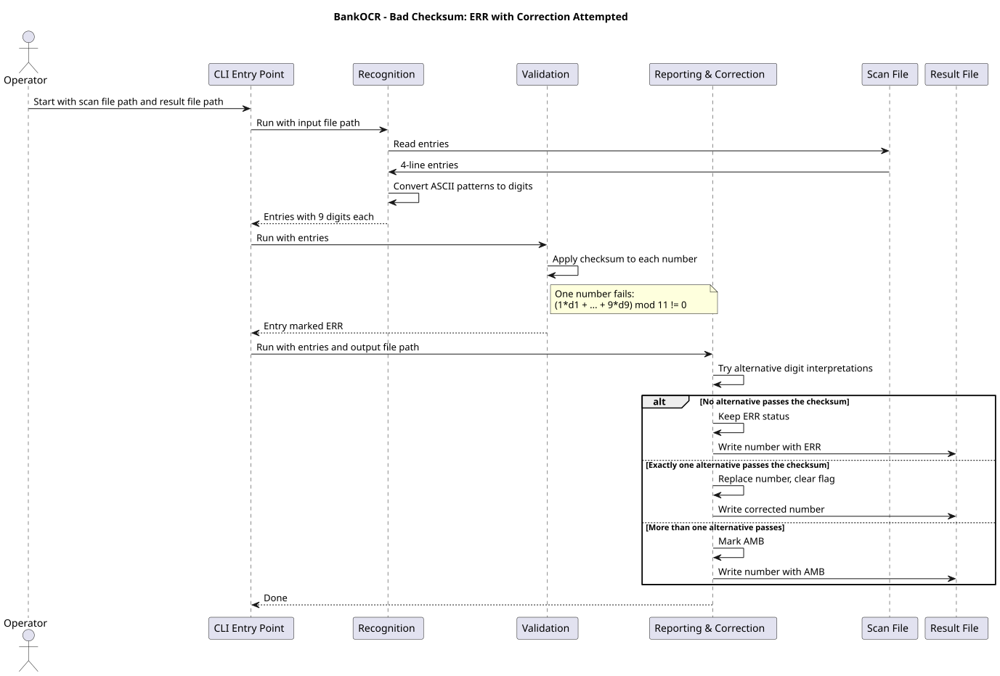
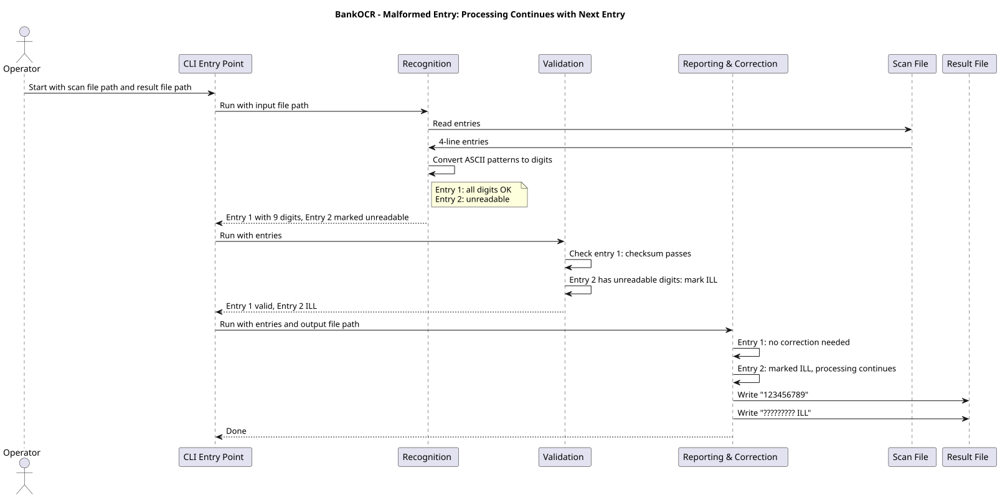

# 6. Runtime View

This chapter shows how the components cooperate at runtime for the most
important scenarios. In every scenario the CLI Entry Point runs the three
modules in a fixed order: Recognition, Validation, then Reporting & Correction.

## 6.1 Happy Path: All Digits Recognised and Checksum Passes

The Operator submits a scan file where every digit is recognised and every
account number passes the checksum. The result file contains one number per
line with no status flags.

## 6.2 Unreadable Digit: ILL, Correction Attempted

The scan file contains an entry where one digit does not match any known
pattern. Recognition marks the digit as unreadable. Validation marks the entry
`ILL`. Reporting & Correction tries alternative interpretations for the
unreadable digit. If no alternative passes the checksum, the entry keeps the
`ILL` status. If exactly one passes, the number is replaced. If more than one
passes, the entry is marked `AMB`.

## 6.3 Bad Checksum: ERR with Correction

The scan file contains an entry where all digits are recognised but the
checksum fails. Validation marks the entry `ERR`. Reporting & Correction tries
alternative digit interpretations. If no alternative passes the checksum, the
entry keeps `ERR`. If exactly one passes, the number is replaced. If more than
one passes, the entry is marked `AMB`.

## 6.4 Malformed Entry: Processing Continues

The scan file contains an entry that Recognition cannot read. Recognition
marks the entry as unreadable. Validation marks it `ILL`. Reporting &
Correction writes the entry with the `ILL` status. The entry is marked and
processing continues with the next entry. The program always produces a
result line for every entry in the file.

