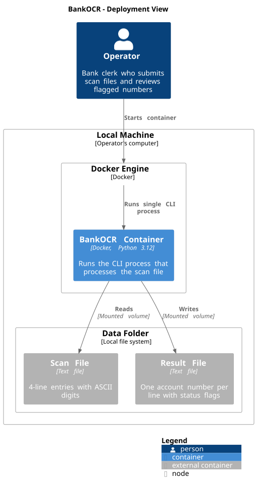

# 7. Deployment View

## 7.1 Infrastructure

BankOCR runs on the Operator's local machine. The machine has Docker installed.
No server, cloud service or network connection is required.

| Element | Technology | Purpose |
|---------|-----------|---------|
| Local Machine | The Operator's computer | Hosts Docker, the data folder and the BankOCR container |
| Data Folder | Local file system | Contains the scan file and the result file; mounted into the container as a volume |
| Docker Engine | Docker | Runs the BankOCR container |
| BankOCR Container | Docker image with Python 3.12 | Runs the CLI process that processes the scan file |
| Scan File | Plain text file in the data folder | Input: 4-line entries with ASCII digits |
| Result File | Plain text file in the data folder | Output: one account number per line with status flags |

## 7.2 Deployment Diagram

## 7.3 How It Runs

The image is built once with:

    docker build -t bankocr .

The Operator runs the kata with (ADR-002, ADR-004):

    docker run --rm -v "$(pwd)/data":/data bankocr

1. The Operator places the scan file in the `data` folder on the local machine.
2. The Operator runs the command above. Docker mounts the `data` folder at
   `/data` inside the container and starts a single CLI process.
3. The CLI reads `/data/scan.txt` and writes `/data/result.txt` by default. If
   the Operator passes two arguments (input path, output path), those paths are
   used instead.
4. Python 3.12 is inside the Docker image, so no Python installation is needed
   on the local machine.
5. When the CLI finishes, the container exits and is removed (`--rm`).
6. The Operator reviews the result file in the `data` folder on the local
   machine.

To run the tests:

    docker run --rm --entrypoint pytest bankocr
