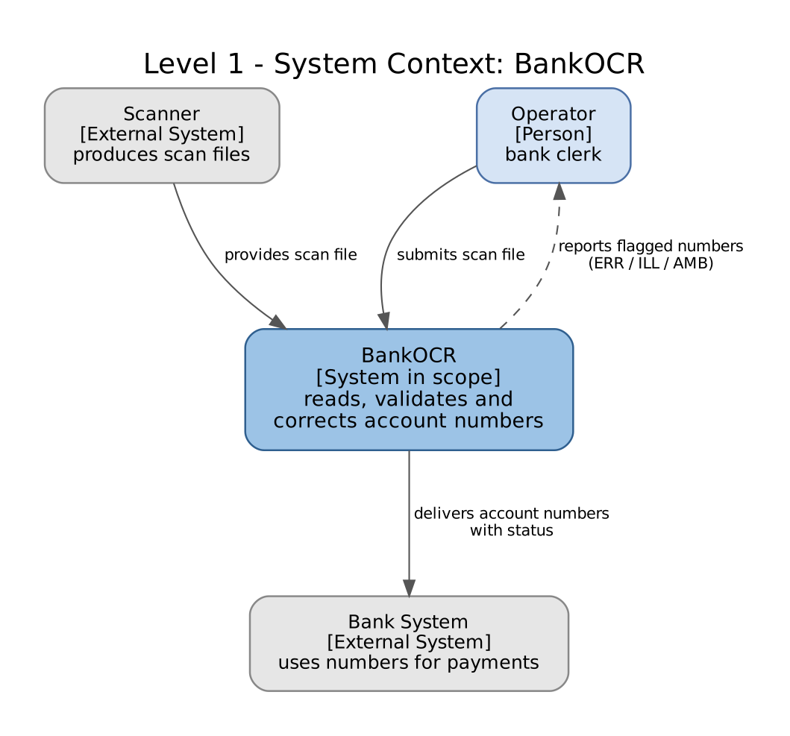
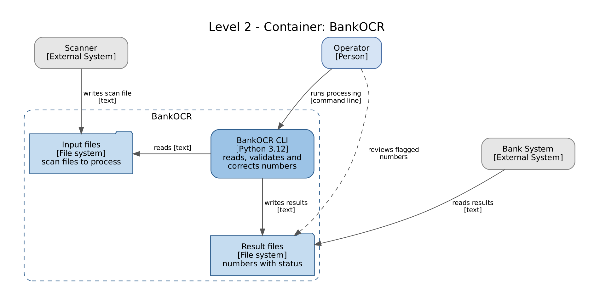

## Level 1 - System Context

BankOCR gets scan files from the scanner and the operator, and sends the results to the bank system. The operator also checks the numbers that are marked as ERR, ILL or AMB.

## Level 2 - Container

BankOCR is a program that reads input files and writes result files. Recognition, Validation and Reporting are parts of that program, so they are not separate containers.
